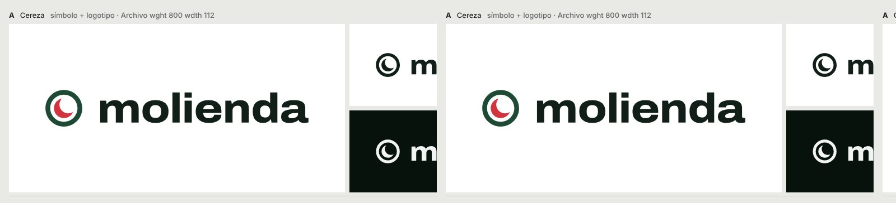
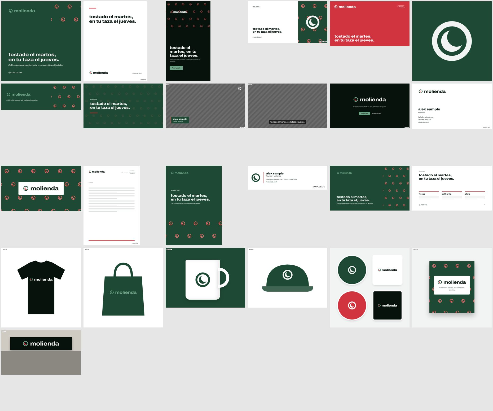
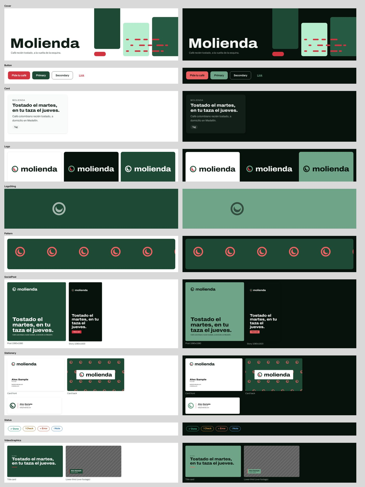

# brand-kit

A Claude skill that works like a senior brand designer: from one brief it builds a **complete brand kit**
(creative platform, logo, type, colour, spacing, corner radius, shadows, motion, pattern, imagery, AI prompts and
voice), checks it, applies it to social, video, stationery and merch, and delivers it as a **claude.ai Design
System artifact**. Clients and Claude then use that artifact for every new document, post, video and product.

> **ES:** Skill de Claude que actúa como diseñador gráfico senior: con un solo brief crea un brand kit completo
> (plataforma creativa, logo, tipografía, color, espaciado, esquinas, sombras, movimiento, patrón, imágenes,
> prompts de IA y voz), lo aplica a redes, video, papelería y merchandising, y lo entrega como un artefacto
> *Design System* de claude.ai (Overview · Colors · Typography · Spacing · Corner radius · Shadows · Duration ·
> Easing · Components · Assets · Files) que tu equipo y Claude reutilizan para todo. Los kits salen en español o
> inglés (`--doc-lang es`).



## What you get

| Output | Where |
|---|---|
| 1–4 identity routes compared side by side (board, cards, comparison table), one recommended | `WORK/board.png`, `WORK/sets/X/card.png` |
| Guidelines PDF (13 pages with `--full`), logo SVG/PNG versions, app icon, favicons | `WORK/kit/X/` |
| Design tokens: CSS, SCSS, Tailwind, DTCG JSON, GIMP palette, fonts.css | `WORK/kit/X/tokens/` |
| Brand system: type scale, spacing, radius, shadows, **duration and easing** derived from the brand's axes; platform, voice, messaging, imagery, AI image/video prompts, motion principles | `WORK/sets/X/system.json` |
| 25 applications: Instagram post/portrait/story, LinkedIn, YouTube thumbnail, avatar, banner, video title card / lower third / subtitles / end card, business card, letterhead, document cover, email signature, slides, t-shirt, tote, mug, cap, stickers, packaging, storefront sign; brand pattern; animated logo sting | `WORK/applications/X/` |
| **Design System artifact**: README brand book + 11 sections, tokens.json (light + dark), brand fonts, live component previews (Logo, Pattern, Button, Card, Status, SocialPost, VideoGraphics, LogoSting, Stationery), cover, asset groups (Logos, Patterns, Social, Video, Stationery, Merch, Guidelines) | `WORK/design-system/X/` → published to claude.ai |



Everything is measured where it can be: WCAG contrast in both themes, colour-blindness simulation, glyph coverage
for the brand's languages, font licences, logo renders at 16/32 px, text contrast on every application. Gates are
measured failures; heuristics are labelled as warnings; taste is labelled as judgement. Empty strategy fields are
left out, never invented; sample contact data and mock-ups are labelled on the images.



## Install

**Claude Code (plugin):**
```
/plugin marketplace add SamyFrost/brand-kit-skill
/plugin install brand-kit
```
or copy `skills/brand-kit/` to `~/.claude/skills/brand-kit/`.

**claude.ai / Claude app:** `python3 tools/package_skill.py` → upload `dist/brand-kit.zip` in
Settings → Capabilities → Skills.

Python 3.10+ with `pip install -r requirements.txt` (fontTools, uharfbuzz, skia-pathops) and a Chromium-based
browser for rendering (`brand.py check` tells you what is missing). With `uv` the scripts fetch their own packages.

## Use

Ask in your own words: *"Necesito el branding completo para mi café"*, *"create a brand kit for…"*,
*"rebrand our logo and build the guidelines"*. The skill asks one intake message, proposes the creative platform
and routes, stops at a checkpoint for you to pick, then builds the full system and publishes the Design System.

Commands (all through `skills/brand-kit/scripts/brand.py`):

| Step | Command |
|---|---|
| intake | `check`, `init NAME --sets 3 --langs es --doc-lang es …`, `site extract URL WORK` |
| routes | `fonts search …`, `logos WORK`, `build WORK`, `mix WORK A:logo B:palette --as D` |
| chosen route | `kit WORK/sets/A --full`, `system WORK/sets/A`, `apps WORK/sets/A` |
| Design System | `ds WORK/sets/A`, `ds-index WORK/design-system/A --uploads uploads.json --by NAME` |
| review | `critique --site URL` |

The publish sequence is in `skills/brand-kit/references/design-system-artifact.md`.

## Develop

```
pip install -r requirements-dev.txt
python -m unittest discover -s tests
python tools/smoke_test.py
```
In a root container (no Chrome sandbox) three browser-launch tests and one Chromium colour-rounding test fail;
they pass on CI runners.

## Credits

Built on [brand-identity-skill](https://github.com/fatihaydost/brand-identity-skill) by Fatih Aydost (MIT): the
identity engine (logo construction, palette building and audits, font catalogue and audits, guidelines kit, site
preview). brand-kit adds the creative framework, the derived system foundations (spacing, radius, shadow, motion),
the applications renderer, imagery and AI-prompt direction, Spanish labels and the Design System artifact export.
See `THIRD_PARTY_NOTICES.md` and `TRADEMARKS.md`. Licence: MIT.
